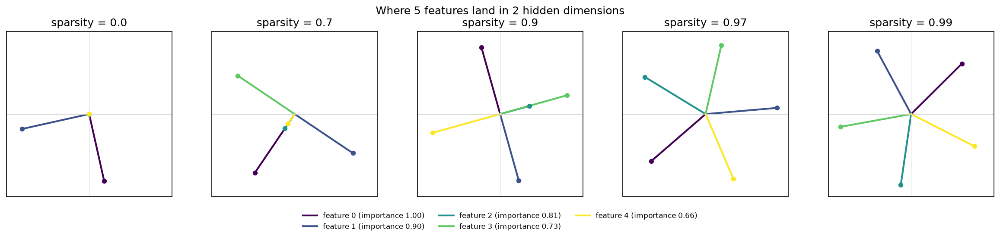
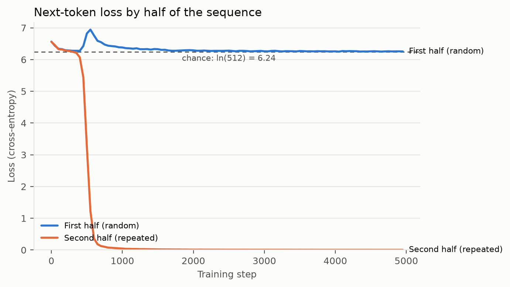
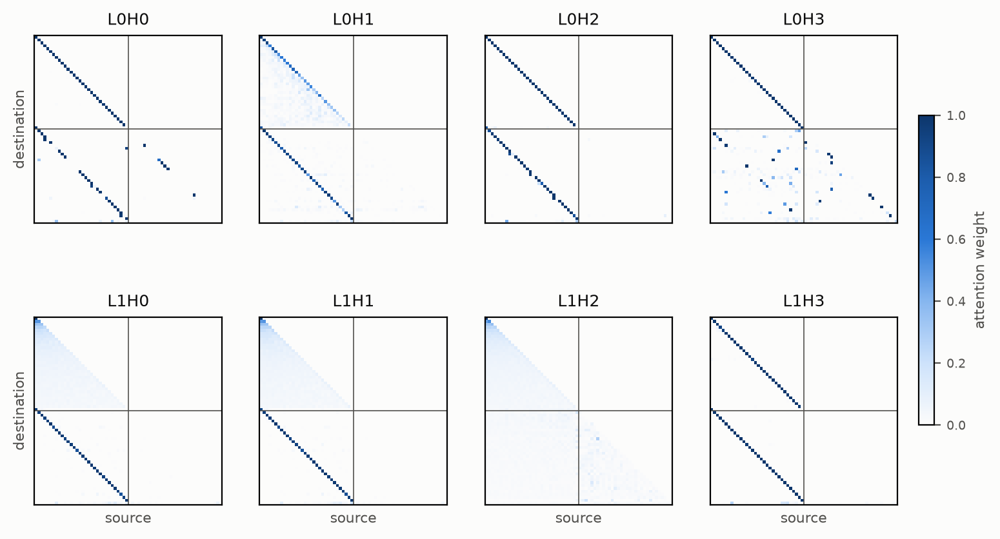
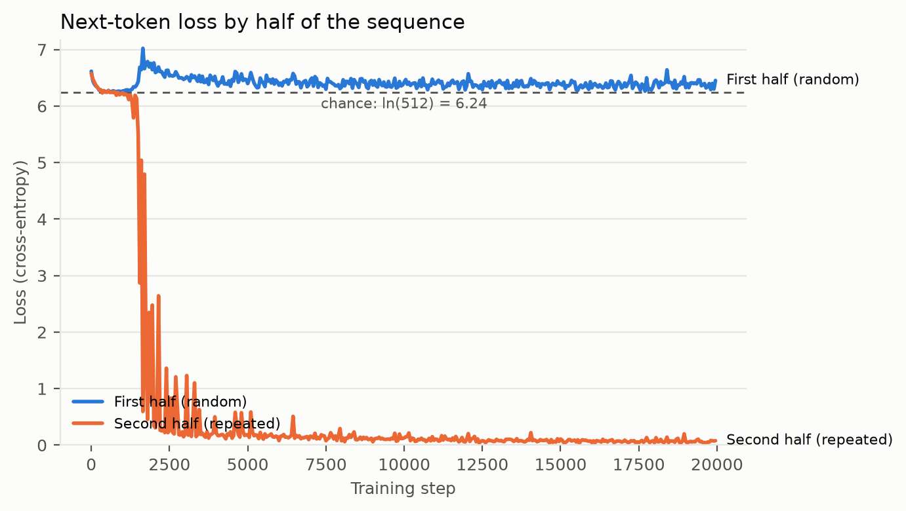
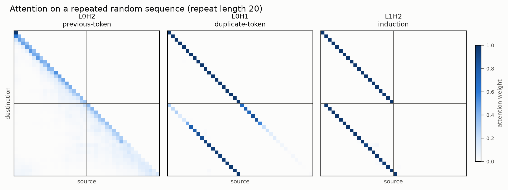
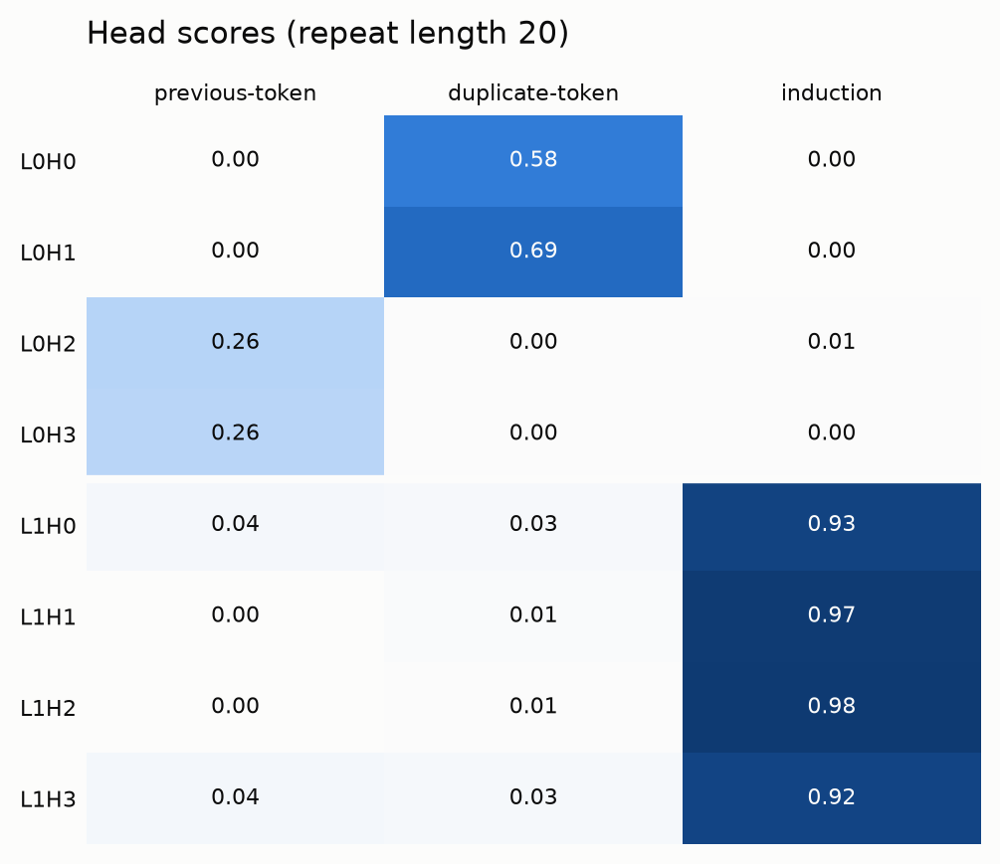
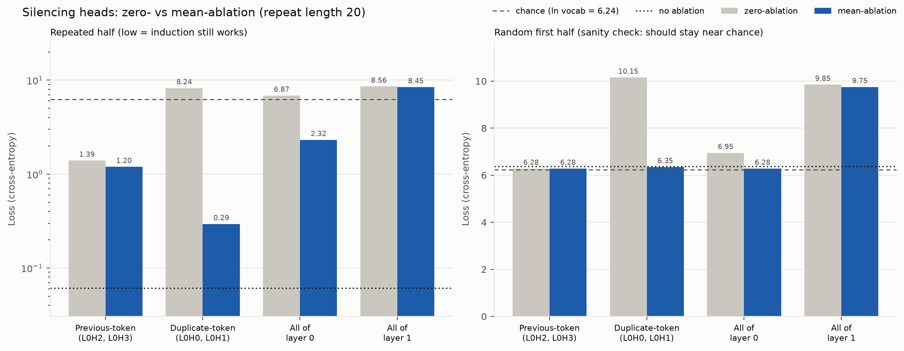

# induction-heads

Training a 2-layer attention-only transformer from scratch and finding - then causally verifying - the induction-head circuit described in Anthropic's [*A Mathematical Framework for Transformer Circuits*](https://transformer-circuits.pub/2021/framework/index.html) and [*In-context Learning and Induction Heads*](https://transformer-circuits.pub/2022/in-context-learning-and-induction-heads/index.html).

> **Status:** results on synthetic data are done: the induction circuit forms, the heads are identified, and ablations confirm they matter. Next: the same tests on natural text. This README is updated as results come in.

## Why this project

The question I keep coming back to is how networks learn and represent things - how simple units give rise to understanding. I first ran into it with robot swarms ([PiELo](https://github.com/empollak/PiELo-MQP), my undergraduate thesis), where small local rules build into global behaviour. Induction heads are the cleanest example of the same thing inside a transformer: two attention heads, each doing something simple, combine into a general "copy what came next last time" algorithm, and that algorithm is a large part of how models learn in context.

The goal is to build the model myself, watch the circuit form, and prove it does what I think it does by messing with it (in a smart way) and seeing what breaks and **how**.

## What an induction head does

Given a sequence like `... A B ... A`, an induction head predicts `B`. It needs two heads working together:

1. **Previous-token head (layer 0):** at each position, copies in information about the token just before it. After this, the position holding `B` also "knows" it came after `A`.
2. **Induction head (layer 1):** at the current `A`, looks back for a position whose previous token was `A` - that's the earlier `B` - and copies `B` into the prediction.

## Plan

| Step | What | Status |
|---|---|---|
| 0 | Warm-up: reproduce the *Toy Models of Superposition* result | Done |
| 1 | Build the model (embeddings, attention, residual stream; no MLPs) + training loop | Done |
| 2 | Train on synthetic repeated sequences; confirm the loss drop on the repeated half | Done |
| 3 | Plot attention patterns and score every head; identify the previous-token heads (L0) and induction heads (L1) | Done |
| 4 | Causal test: ablate heads and measure how much loss on the repeated half goes back up | Done (synthetic data) |
| 5 | Repeat on natural text | Not started |

## Results

### Warm-up: superposition

Reproduced the core result of *Toy Models of Superposition* (5 features squeezed into 2 dimensions):

- **Dense features:** the model keeps 2 features at right angles and drops the other 3.
- **Sparser features:** features pair up as antipodal pairs (pointing in opposite directions).
- **Sparsest features:** all 5 are stored, arranged as a pentagon.



Code: [`notebooks/01_superposition.py`](notebooks/01_superposition.py). More figures: [`figures/`](figures/).

### First attempt: the model found a positional shortcut

My first training run used sequences of 32 random tokens repeated once (64 tokens total). It looked like a success: the loss on the repeated half fell from 6.24 (random guessing over 512 tokens) to 0.004 in a sudden drop between steps ~400 and ~650, the phase change the induction-heads paper describes.



The attention patterns didn't match an induction circuit, though:

- **Layer-0 heads attended to the earlier copy.** Real induction needs two layers: layer 0 has no way to know which earlier position comes *after* a matching token, because that information only exists once a previous-token head has moved it.
- **No previous-token head.** No head attended to position i − 1 across the whole sequence, which is the first half of the circuit.



Because the copy always started exactly 32 positions later, the model could solve the task by position alone: "at position i, copy whatever is at position i − 31". No token matching required, and one layer is enough.

**Test:** I gave the trained model sequences that repeat after 20 tokens instead of 32. A real induction circuit matches tokens by content, so it should work at any distance. The repeated-half loss was **11.4**: worse than random guessing (6.24), because the model confidently copied the token 31 positions back, which was now the wrong one. Shortcut confirmed.

**Fix:** the repeat length now changes every batch (8 to 32 tokens), so position no longer tells the model where the earlier copy is. Code for this run: [`notebooks/02_induction_synthetic.py`](notebooks/02_induction_synthetic.py), frozen at the [`shortcut-run`](https://github.com/LorenzoManfrediSegato/induction-heads/tree/shortcut-run) tag.

### Induction heads (synthetic data)

The model is the one described under [Model](#model). Each training sequence is a random first half of length L followed by an exact repeat of it, with L drawn from 8 to 32 so the model can't use the shortcut above. After 20,000 steps, loss on the repeated half is 0.03 / 0.06 / 0.18 at L = 10 / 20 / 32. The drop happens suddenly, around step 1,600.



All numbers below use L = 20 and a fixed batch of 256 sequences (seed 0) unless stated otherwise.

#### What the heads do





I scored each head by how much attention it puts on one target position, averaged over the batch:

- **Previous-token:** position i attends to i − 1.
- **Duplicate-token:** in the second half, position i attends to the earlier copy of its own token (i − L).
- **Induction:** in the second half, position i attends to the token *after* the earlier copy (i − L + 1), which is the token it should predict next.

I found three groups of heads. All four layer-1 heads are induction heads. L0H2 and L0H3 are previous-token heads. L0H0 and L0H1 are duplicate-token heads. The roles hold at every repeat length I tested:

| Head | Role | L = 10 | L = 20 | L = 32 |
|---|---|---|---|---|
| L1H0 | Induction | 0.88 | 0.93 | 0.89 |
| L1H1 | Induction | 0.89 | 0.97 | 0.92 |
| L1H2 | Induction | 0.91 | 0.98 | 0.91 |
| L1H3 | Induction | 0.89 | 0.92 | 0.90 |
| L0H2 | Previous-token | 0.35 | 0.27 | 0.19 |
| L0H3 | Previous-token | 0.34 | 0.26 | 0.18 |
| L0H0 | Duplicate-token | 0.78 | 0.59 | 0.34 |
| L0H1 | Duplicate-token | 0.08 | 0.70 | 0.72 |

(Table from `04_head_scores.py`, 64 sequences per length. All other scores are 0.08 or below.)

The previous-token scores look low, but attention spread evenly over the visible positions would score about 0.14 / 0.08 / 0.06 at these lengths, so these heads sit 2.5-3× above even spreading at every length. The two duplicate-token heads seem to split the job by repeat length: L0H0 is strongest on short repeats, L0H1 on long ones.

This is the circuit described in *A Mathematical Framework for Transformer Circuits*. A previous-token head in layer 0 writes "the token before me was X" into each position. Layer-1 heads can then look for the position whose previous token matches their current token - which is exactly the position to copy from!

#### Causal tests

Attention patterns show where heads look, not whether the model depends on them. To test that, I silenced groups of heads and measured the loss again. I used two ways of silencing a head:

- **Zero-ablation:** replace the head's output with zeros.
- **Mean-ablation:** replace the head's output with its average over the batch (per position), which removes the information specific to each sequence but keeps the output in a range the model saw during training.

As a sanity check, I also measured loss on the random first half, where there is nothing to copy. A clean ablation should leave it near its normal value (6.38).



| Silenced | Zero: repeated / first half | Mean: repeated / first half |
|---|---|---|
| Nothing | 0.061 / 6.38 | - |
| Previous-token heads (L0H2, L0H3) | 1.39 / 6.28 | 1.20 / 6.28 |
| Duplicate-token heads (L0H0, L0H1) | 8.25 / 10.15 | 0.29 / 6.35 |
| All of layer 0 | 6.87 / 6.95 | 2.32 / 6.28 |
| All of layer 1 | 8.56 / 9.85 | 8.45 / 9.75 |

What I found (reading the mean-ablation numbers where they pass the sanity check):

- **The previous-token heads matter.** Silencing them makes the repeated-half loss about 20× worse (0.06 → 1.20), but induction doesn't fully break.
- **The duplicate-token heads are a partial backup.** On their own they barely matter (0.29). Silenced together with the previous-token heads, the damage roughly doubles (1.20 → 2.32). So layer 1 can fall back on them when the previous-token signal is missing.
- **Layer 1 still does some induction with all of layer 0 averaged away** (2.32, far below chance). I can't explain this yet.
- **Layer 1 is necessary, but removing it isn't a clean test of induction.** Both ablation methods push the repeated half above chance, but they also push the random first half to ~9.8. Without layer 1, the model makes confident wrong guesses everywhere, so this number overstates how much of it is lost induction.

#### A note on method: zero-ablation misled me

My first layer-0 runs used zero-ablation, and they made the duplicate-token heads look essential: the repeated-half loss went from 0.06 to 8.25. But the first-half loss also jumped to 10.15 - far above chance - on data where those heads have nothing to copy, so zeroing them was breaking the model. Mean-ablation passed the sanity check and actually revealed something else entirely: a partial backup, not an essential part. Since then, I report both methods and always check the first half.

#### Open questions

- What lets layer 1 do partial induction with layer 0 averaged away?
- What is layer 1 doing in the random first half? In the example in Figure 1a, its heads attend to the current token there, and removing layer 1 breaks that half too.
- Does the duplicate-token backup change with repeat length, given that L0H0 and L0H1 seem to cover different lengths?
- Next: train on text and check whether the same heads form and pass the same causal tests.

## Model

A 2-layer, attention-only transformer (4 heads per layer, `d_model` 64, ~102k parameters), trained on random token sequences that repeat. Full configuration, and the reasoning behind each choice, in [`MODEL_CONFIG.md`](MODEL_CONFIG.md).

## Repository layout

```
induction-heads/
├── src/induction_heads/
│   ├── config.py     # model + training settings (see MODEL_CONFIG.md)
│   ├── data.py       # repeated random sequences; loss split by half for logging
│   ├── model.py      # the 2-layer attention-only transformer, with head ablation
│   ├── scores.py     # previous-token, duplicate-token and induction head scores
│   └── plotting.py   # loss curves, attention patterns, head scores, ablations
├── tests/            # model sanity checks (shape, causality, initial loss), data, head scores
├── notebooks/        # runnable experiments, numbered in the order they were run
├── notes/            # reading notes, numbered (01-zoom-in.md, ...)
├── figures/          # saved plots
├── MODEL_CONFIG.md
└── README.md
```

## Running it

Requires [uv](https://docs.astral.sh/uv/) and Python 3.12. Runs on Apple Silicon (PyTorch MPS) or CPU.

```bash
git clone https://github.com/LorenzoManfrediSegato/induction-heads.git
cd induction-heads
uv sync
uv run pytest                                              # sanity checks
uv run python notebooks/01_superposition.py                # superposition warm-up
uv run python notebooks/03_induction_synthetic_varlen.py   # train the model (saves weights to runs/)
uv run python notebooks/04_head_scores.py                  # head scores at L = 10 / 20 / 32
uv run python notebooks/05_ablations.py                    # zero- and mean-ablations
uv run python notebooks/06_figures.py                      # figures used in this README
```

Notebooks 04-06 load the weights saved by 03, so run 03 first. Training takes well under a minute on an M-series Mac.

## How I used AI

This is a learning project, so I set rules for where AI was and wasn't allowed:

- **Written by hand, without AI:** the model (embeddings, attention, the forward pass), the training loop, the head-scoring function, and the causal experiments (ablations). These are typed out by hand, and I struggle with any issues I may have for ~30 minutes before looking something up.
- **AI-assisted:** "plumbing" that isn't the point of the exercise - config, synthetic data generation, plotting, logging, figure styling, and the tests for the head-scoring function. I've read and can explain every line of it.
- **Learning and notes:** I worked through the papers with Claude, asking questions as I read. The files in [`notes/`](notes/) were compiled from those conversations, parts written by me, parts by Claude; open questions I haven't resolved yet are marked as such.
- **This README** was drafted with Claude and edited by me.

## References

- Olah et al., [*Zoom In: An Introduction to Circuits*](https://distill.pub/2020/circuits/zoom-in/) (2020)
- Elhage et al., [*A Mathematical Framework for Transformer Circuits*](https://transformer-circuits.pub/2021/framework/index.html) (2021)
- Olsson et al., [*In-context Learning and Induction Heads*](https://transformer-circuits.pub/2022/in-context-learning-and-induction-heads/index.html) (2022)
- Elhage et al., [*Toy Models of Superposition*](https://transformer-circuits.pub/2022/toy_model/index.html) (2022)

## License

MIT - see [`LICENSE`](LICENSE).
